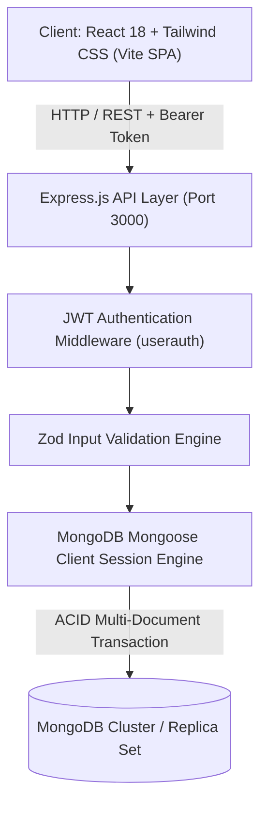
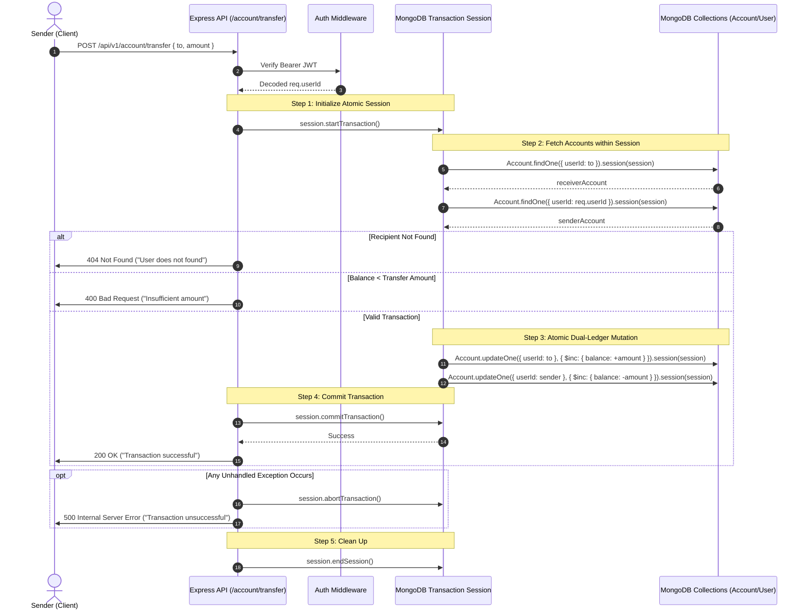

# 💸 Niropay

> A production-grade Fintech digital wallet & transaction simulation engine engineered with MongoDB ACID multi-document transactions, Express, React, and Tailwind CSS.

[](https://nodejs.org/)
[](https://expressjs.com/)
[](https://www.mongodb.com/)
[](https://react.dev/)
[](https://tailwindcss.com/)
[](https://jwt.io/)
[](https://opensource.org/licenses/MIT)

---

## 📌 Table of Contents

- [Overview](#-overview)
- [System Architecture & ACID Guarantees](#-system-architecture--acid-guarantees)
- [Core Features](#-core-features)
- [Tech Stack](#-tech-stack)
- [Directory Structure](#-directory-structure)
- [API Specification](#-api-specification)
- [Local Development Guide](#-local-development-guide)
- [Security Considerations](#-security-considerations)
- [Author & Credits](#-author--credits)
- [License](#-license)

---

## 🌟 Overview

**Niropay** is a fintech wallet application designed to simulate frictionless, real-time peer-to-peer (P2P) payments with strict transactional integrity. 

In distributed financial software, naive balance updates like:
```javascript
// ANTI-PATTERN: Prone to race conditions and double-spending
await Account.updateOne({ userId: sender }, { $inc: { balance: -amount } });
await Account.updateOne({ userId: receiver }, { $inc: { balance: amount } });
```
lead to catastrophic data anomalies: network drops between operations create orphaned debits, and concurrent requests can easily double-spend unallocated funds.

**Niropay addresses this challenge head-on** by implementing **multi-document ACID transactions via MongoDB Client Sessions**. Every fund transfer is executed in an isolated atomic session: funds are verified, the sender's account is debited, and the recipient's account is credited concurrently. If any stage encounters an exception or condition mismatch, the entire transaction is automatically rolled back, guaranteeing zero ledger corruption.

---

## 🔄 System Architecture & ACID Guarantees

### 1. High-Level Architecture



### 2. Atomic Transaction Flow Diagram

The diagram below details the atomic lifecycle of a P2P fund transfer through `/api/v1/account/transfer`:



### 3. The Four Pillars of ACID in Niropay

| Principle | Implementation in Niropay | Guarantee |
| :--- | :--- | :--- |
| **Atomicity** | `session.startTransaction()`, `commitTransaction()`, and `abortTransaction()` | Both the debit and credit operations succeed as a single unit of work, or both fail with zero state change. |
| **Consistency** | Strict pre-validation of sender funds (`senderAccount.balance >= transferAmount`) and atomic `$inc` operators | The system-wide monetary supply remains invariant; balances cannot drop into negative values. |
| **Isolation** | Snapshot isolation levels enforced across MongoDB replica-set transactions | Concurrent transactions cannot read intermediate debit/credit states, preventing dirty reads and race conditions. |
| **Durability** | Committed transactions are written to MongoDB's write-ahead transaction log (oplog/journal) | State changes persist safely against unexpected crashes or network interruptions. |

---

## ⚡ Core Features

- 🛡️ **Zero Double-Spending Guarantees**: MongoDB atomic multi-document transactions ensure that simultaneous requests cannot exploit race conditions.
- 💳 **Dual-Ledger Atomic Accounting**: Immediate synchronization of balances between sender and recipient accounts without orphaned entries.
- 📊 **Real-Time Banking Dashboard**: Instant retrieval of user identity (`/api/v1/user/me`) and live wallet balance (`/api/v1/account/balance`).
- 🔍 **Recipient Search**: Searchable directory allowing users to discover registered peers for instant transfers (`/api/v1/user/bulk`).
- 🔐 **Stateless Authentication**: Fast, secure token issuance and verification with JSON Web Tokens (JWT) and bearer middleware.
- 📐 **Rigorous Schema Validation**: Strict input boundary validation via Zod schemas for sign-up, sign-in, and account mutations.
- 🎨 **Responsive Dashboard Interface**: Clean, mobile-friendly interface styled with modern Tailwind CSS utilities and React Router navigation.

---

## 🛠️ Tech Stack

### Backend

| Technology | Version | Purpose |
| :--- | :--- | :--- |
| **Node.js** | `>= 18.0.0` | Server runtime environment |
| **Express.js** | `^4.18.2` | RESTful API routing and middleware framework |
| **MongoDB / Mongoose** | `^8.1.0` | Object Data Modeling (ODM) with multi-document ACID transactions |
| **Zod** | `^3.22.4` | TypeScript-first schema validation with static type inference |
| **JSON Web Token (JWT)** | `^9.0.2` | Stateless authentication and token verification |
| **CORS** | `^2.8.5` | Cross-Origin Resource Sharing configuration |

### Frontend

| Technology | Version | Purpose |
| :--- | :--- | :--- |
| **React** | `^18.2.0` | Declarative component-based UI library |
| **Vite** | `^5.0.8` | Next-generation frontend build tool and dev server |
| **Tailwind CSS** | `^3.4.1` | Utility-first CSS framework for responsive layout design |
| **React Router DOM** | `^6.22.3` | Client-side dynamic declarative routing |
| **Axios** | `^1.6.8` | Promise-based HTTP client for API communication |

---

## 📂 Directory Structure

```text
Niropay/
├── backend/
│   ├── config.js              # Environment secrets and JWT secret configuration
│   ├── db.js                  # Mongoose connection and User & Account schemas
│   ├── index.js               # Express application entrypoint and root router mount
│   ├── middlewares.js         # JWT bearer authentication middleware (userauth)
│   ├── package.json           # Backend dependencies and scripts
│   └── routes/
│       ├── account.js         # Balance retrieval and atomic /transfer routes
│       ├── index.js           # API v1 sub-router aggregator
│       └── user.js            # Auth routes (/signup, /signin, /me, /bulk, /)
│
├── frontend/
│   ├── index.html             # Vite single-page application entry HTML
│   ├── package.json           # Frontend dependencies and Vite build scripts
│   ├── postcss.config.js      # PostCSS configuration for Tailwind CSS
│   ├── tailwind.config.js     # Tailwind CSS theme configuration and scan paths
│   ├── vite.config.js         # Vite configuration with React plugin
│   └── src/
│       ├── App.css            # Base application stylesheet
│       ├── App.jsx            # Top-level route definitions (BrowserRouter)
│       ├── index.css          # Tailwind CSS layer directives (@tailwind)
│       ├── main.jsx           # React DOM root bootstrapping
│       ├── Components/        # Reusable UI component library
│       │   ├── AlreadyCompo.jsx      # Navigation redirect helper ("Already have account?")
│       │   ├── ButtonCompo.jsx       # Standardized actionable button component
│       │   ├── HeadingComponent.jsx  # Primary page title heading
│       │   ├── HeadingTwo.jsx        # Section sub-header
│       │   ├── InputCompo.jsx        # Labeled form text input
│       │   ├── NameInitial.jsx       # Avatar with user initials
│       │   └── UserCompo.jsx         # User list and search component
│       └── pages/             # Route-level view pages
│           ├── DashBoard.jsx  # Main user dashboard with live balance and peer list
│           ├── Home.jsx       # Landing welcome page with auth routes
│           ├── SendMoney.jsx  # Transfer initiation modal & balance checks
│           ├── Signin.jsx     # User login screen
│           └── Signup.jsx     # User registration screen
└── README.md                  # Project documentation
```

---

## 📡 API Specification

Base URL: `http://localhost:3000/api/v1`

### 1. Authentication & User Endpoints (`/api/v1/user`)

| Method | Endpoint | Auth | Description | Payload / Query |
| :--- | :--- | :--- | :--- | :--- |
| `POST` | `/signup` | Public | Register new user & seed wallet balance | `{ "username": "...", "password": "...", "firstName": "...", "lastName": "..." }` |
| `POST` | `/signin` | Public | Authenticate user credentials & receive token | `{ "username": "...", "password": "..." }` |
| `GET` | `/me` | `Bearer <Token>` | Get profile details for authenticated user | *None* |
| `PUT` | `/` | `Bearer <Token>` | Update user profile fields | `{ "password"?: "...", "firstName"?: "...", "lastName"?: "..." }` |
| `GET` | `/bulk` | Public | Search registered users by name prefix | Query: `?filter=john` |

#### `POST /signup` Sample Response
```json
{
  "message": "User created successfully",
  "YourBalance": 5420,
  "token": "eyJhbGciOiJIUzI1NiIsInR5cCI6IkpXVCJ9..."
}
```

---

### 2. Account & Ledger Endpoints (`/api/v1/account`)

| Method | Endpoint | Auth | Description | Payload |
| :--- | :--- | :--- | :--- | :--- |
| `GET` | `/balance` | `Bearer <Token>` | Fetch current user wallet balance | *None* |
| `POST` | `/transfer` | `Bearer <Token>` | Execute atomic transfer to recipient | `{ "to": "<RecipientUserId>", "amount": 250 }` |

#### `POST /transfer` Status Codes & Responses

| Status Code | Response Body | Condition |
| :--- | :--- | :--- |
| `200 OK` | `{"msg": "Transaction successful"}` | Transfer committed successfully |
| `400 Bad Request` | `{"msg": "Insufficient amount"}` | Sender account balance is less than requested amount |
| `404 Not Found` | `{"msg": "User does not found"}` | Recipient account does not exist |
| `403 Forbidden` | `{"msg": "error at middleware"}` | Invalid or missing Bearer authorization token |
| `500 Server Error` | `{"msg": "Transaction unsuccessful"}` | Internal error; transaction automatically aborted |

---

## 🚀 Local Development Guide

### Prerequisites

- [Node.js](https://nodejs.org/) (v18.x or higher)
- [npm](https://www.npmjs.com/) or [yarn](https://yarnpkg.com/)
- [MongoDB Atlas](https://www.mongodb.com/cloud/atlas) account OR a local MongoDB instance running with **Replica Set** enabled (required for multi-document ACID transactions).

> 💡 *Note on MongoDB Transactions: Multi-document transactions require a replica set. If testing locally with standalone MongoDB, initiate a local replica set with `rs.initiate()`.*

---

### Step 1: Clone the Repository

```bash
git clone git@github.com:NIRONMAN/Niropay.git
cd Niropay
```

---

### Step 2: Configure & Start the Backend

1. Navigate to the `backend/` directory:
   ```bash
   cd backend
   ```

2. Install dependencies:
   ```bash
   npm install
   ```

3. Configure Environment Variables:
   Create a `.env` file or verify `config.js` and `db.js`:
   ```bash
   # MongoDB Connection String (Atlas or Replica Set)
   MONGO_URI="mongodb+srv://<username>:<password>@cluster.mongodb.net/niropay"

   # Secret Key for JWT Signing
   JWT_SECRET="your_secure_random_jwt_secret"

   # Server Port
   PORT=3000
   ```

4. Start the backend server:
   ```bash
   node index.js
   ```
   The backend server will start listening at `http://localhost:3000`.

---

### Step 3: Configure & Start the Frontend

1. Open a new terminal and navigate to the `frontend/` directory:
   ```bash
   cd frontend
   ```

2. Install dependencies:
   ```bash
   npm install
   ```

3. Launch the Vite development server:
   ```bash
   npm run dev
   ```
   The application will launch and be accessible at:
   ```text
   http://localhost:5173
   ```

---

## 🔒 Security & Architecture Considerations

- **Multi-Document ACID Safety**: Ensures financial ledger integrity by leveraging transactional rollbacks.
- **Input Sanitization**: All endpoint boundaries are strictly verified against Zod schemas, mitigating injection vulnerabilities.
- **Token-Based Stateless Auth**: User authentication state is managed via cryptographically signed JWTs passed through standard `Authorization: Bearer <token>` headers.
- **Production Enhancements**:
  - Store database secrets and JWT secrets in secure environment variables (`process.env`) rather than committing them to version control.
  - Implement password hashing (e.g., using `bcryptjs` / `argon2`) prior to persisting user records.
  - Configure rate limiting on `/transfer` and `/signin` endpoints using tools like `express-rate-limit`.

---

## 👨‍💻 Author & Credits

**Niranjan Dabhade**
- 🌐 Portfolio: [niranjandabhade.dev](https://niranjandabhade.dev)
- 🐙 GitHub: [@NIRONMAN](https://github.com/NIRONMAN)

---

## 📄 License

This project is licensed under the [MIT License](LICENSE).
